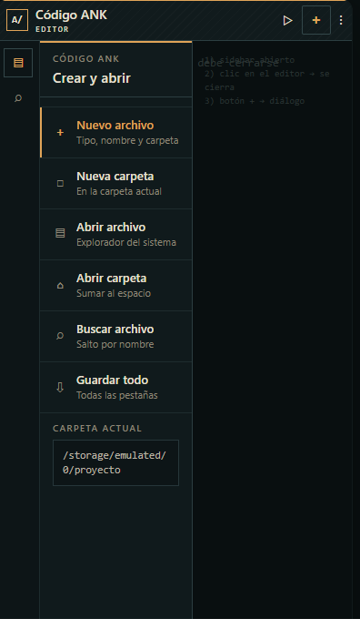
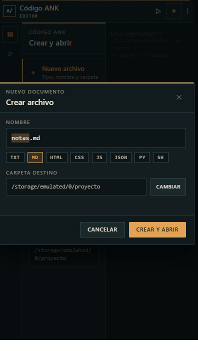

# Código ANK

Editor de código para Android con identidad propia, interfaz en español y
marca **ANK**. El código base es libre (MIT, © 2020 Foxdebug / Ajit Kumar);
el aviso de licencia se conserva en el APK.

## APK

- Archivo: `CodigoANK.apk` (97,37 MB)
- Paquete: `com.ank.codigoank`
- Versión: 1.7.0 (versionCode 1027)
- minSdk 26 · targetSdk 28
- Firmado con `ank.keystore` (alias `codigoank`)
- Incluye el panel 1.7.0 (mini apps) ya integrado; el APK anterior queda en
  `CodigoANK-1.5.8.apk`

SHA-256:

```
8FE4B9F315000A6082049E1EFBDB1A27C465AE10E34F6C601B21A3DF8E06F15E
```

El APK pesa 96 MB porque lleva dentro todo lo que la app necesita para
funcionar sin internet: el binario del asistente (OpenCode 1.19.4 para Linux
ARM64) y el entorno Linux completo (Alpine, `axs`, `proot` y `bash`). No se
descarga nada al instalar ni al preparar el entorno.

## Instalación

1. Pasá `CodigoANK.apk` al teléfono.
2. Permití "instalar apps de origen desconocido".
3. Al no estar en Play Store, Play Protect puede pedir confirmación.

Se instala **encima** de la versión anterior: misma firma y mismo paquete, así
que conserva archivos, ajustes y la carpeta de proyectos.

### Actualizaciones

El panel del asistente se actualiza solo desde GitHub (menú ⋮ → **Actualizar
ANK**): descarga únicamente `version.json`, `ank/ai.js` y `ank/ai.css`, verifica
la firma y lo aplica al reiniciar. No hace falta reinstalar ni usar la PC.

El APK solo se reemplaza cuando cambia la parte nativa (permisos, iconos,
entorno Linux u OpenCode). En ese caso se pasa el archivo nuevo al teléfono por
cable, almacenamiento o la vía que prefieras.

> `web/` queda como herramienta opcional para servir el APK por red local
> (`node web/serve.js`). No participa en las actualizaciones del panel.

No convive con Acode: si ya lo tenés instalado, desinstalalo antes (distinto
paquete, así que no hay conflicto real, pero evita duplicados).

## Asistente IA

Panel propio dentro de la app (botón **IA** en la barra superior) con cuatro
pestañas: Chat, Chats, Apps y Entorno, más Registro. El asistente corre en el
mismo sandbox Alpine que usa la terminal, sin interfaz gráfica y sin permisos
extra.

### Cómo dejarlo funcionando

Son cuatro pasos, una sola vez, desde la pestaña **Entorno**:

1. **Entorno Linux.** Descarga Alpine y las librerías de proot (~20 MB). Es la
   misma instalación que pide la terminal. Requiere red.
2. **Asistente.** Copia el binario incluido en el APK y lo descomprime en el
   almacenamiento privado de la app (~217 MB). Verifica el espacio libre antes
   de empezar (pide unos 320 MB) y muestra la versión al terminar.
3. **Cuenta.** Se pega una clave de API. Por defecto el proveedor es OpenCode
   (`opencode.ai/auth`), que da acceso a los modelos gratuitos. También acepta
   OpenRouter, Anthropic, OpenAI, DeepSeek, Groq y Google.
4. **Proyecto.** Carpeta de trabajo dentro de `/public/proyectos`. Se crea sola
   al enviar el primer mensaje.

La barra inferior muestra el estado (`falta el entorno`, `listo · modelo`, etc.)
y el botón de envío se convierte en **detener** mientras el modelo trabaja.

### Memoria y bitácora

Cada proyecto tiene un `AGENTS.md` con su objetivo, estado, decisiones y una
**bitácora** de lo hablado. La app lo lee en segundo plano para tener contexto:
su contenido **no se muestra en el chat**, va al detalle plegado del bloque de
trabajo. La IA tampoco narra qué archivos leyó ni copia la memoria en la
respuesta; solo entrega el resultado.

La bitácora se alimenta sola con cada pedido (hasta 40 líneas) y, cada ocho
conversaciones, con un resumen automático. Se puede editar a mano desde
**Chats → Memoria**.

### Cómo trabaja

Mientras el asistente lee, escribe o ejecuta comandos, el chat no se llena de
líneas: aparece **un solo renglón** con lo que está haciendo («Leyendo app.js»,
«Escribiendo style.css», «Revisando…») y un punto dorado que indica que sigue
trabajando. Al terminar, ese renglón resume el trabajo («6 pasos · Escribiendo
style.css»).

Si querés ver el detalle, tocá la flecha **›** del bloque: se despliega la lista
completa de pasos y avisos. Si no la tocás, el chat queda limpio y solo se ve la
respuesta final. El detalle se guarda con el chat, así que sigue disponible
cuando lo reabrís.

### Qué hace y qué no

- Ejecuta `opencode run --auto` dentro de la carpeta del proyecto: puede leer y
  escribir archivos del proyecto y correr comandos en el sandbox.
- **No controla la interfaz de la app.** No abre pestañas, no toca ajustes y no
  sale de la carpeta de trabajo.
- Las credenciales quedan en
  `/public/.local/share/opencode/auth.json`, dentro del almacenamiento privado.
- Los modelos `free` no tienen costo y pueden tener límites de uso. La lista se
  lee con `opencode models`; si falla, se usan los sugeridos.

### Si algo falla

La pestaña **Registro** guarda los últimos 400 eventos con hora. **Copiar**
deja todo el registro en el portapapeles y **Diagnóstico** vuelve a comprobar
entorno, binario y credencial. La consola de la pestaña Registro permite lanzar
comandos a mano (`opencode --version`, `opencode auth list`, `df -h /public`).

## Apps

Una **app** es una aplicación que vive dentro de Código ANK. No es un APK: se
guarda en una carpeta del proyecto y el panel la ejecuta aislada en un
`<iframe sandbox>`, con acceso solo a sus propios datos.

Hay dos tamaños:

- **App completa** (opción marcada por defecto en **Crear app**): varias
  pantallas con navegación propia, datos que se guardan, alta/edición/borrado,
  estados vacíos y diseño terminado. Es la que conviene para algo real.
- **Mini app**: una sola pantalla, para algo rápido (una calculadora, un
  contador, una nota).

```
proyectos/gastos/
  ankapp.json     manifiesto: id, nombre, versión, icono, tipo, permisos, inicio
  index.html      pantalla inicial
  style.css       opcional, se inyecta solo
  app.js          opcional, se inyecta solo
```

Se piden desde la pestaña **Apps** con **Crear app** (nombre, qué hace y
permisos) o directamente en el chat: «creá una app completa para anotar gastos».
La IA responde con bloques `ank:archivo`; al **Aplicar** el archivo queda
escrito y la app aparece en la lista. **Abrir** la ejecuta a pantalla completa y
**Editar** abre el chat de esa carpeta con el pedido listo.

### Exportar como app instalable

**Exportar** deja en `proyectos/<carpeta>/export/` todo lo necesario para
instalarla en el teléfono como aplicación web (PWA):

| Archivo | Para qué |
| --- | --- |
| `index.html` | la app entera en un archivo, con su CSS y JS incrustados |
| `manifest.webmanifest` | nombre, colores e ícono para instalarla |
| `sw.js` | copia local, para que abra sin internet |
| `icon.svg` | ícono generado a partir del nombre |
| `LEEME.md` | pasos para publicarla y instalarla |
| `app.zip` | todo lo anterior listo para subir |

Para instalarla: subir esa carpeta a GitHub Pages (o cualquier servidor con
HTTPS), abrir la dirección en Chrome y elegir **Instalar aplicación** /
**Agregar a pantalla principal**. Queda con su ícono y abre sin ANK. Los datos
viven en el navegador de la app instalada y no se sincronizan con ANK.

### Permisos

Se declaran en `ankapp.json` y el panel pide consentimiento la primera vez, por
app:

| Permiso | Qué habilita |
| --- | --- |
| `almacenamiento` | datos propios de la app, aislados por app |
| `notificaciones` | aviso dentro de ANK y notificación del sistema si existe |
| `camara` | abrir la cámara y devolver la foto como dataURL |
| `archivos` | elegir archivos y leer/escribir dentro de la carpeta de la app |
| `compartir` | menú de compartir de Android |
| `portapapeles` | copiar texto |
| `vibrar` | vibración corta |

### API disponible dentro de la app

`ANK.storage.get/set/remove/clear`, `ANK.notify(titulo, texto)`,
`ANK.share(texto)`, `ANK.copy(texto)`, `ANK.vibrate(ms)`,
`ANK.fs.list/read/write`, `ANK.pickFile({aceptar})`, `ANK.camera()` y
`ANK.request(permiso)`. No hay `localStorage`: sin acceso directo al
almacenamiento del teléfono.

### Límites

- No corre en segundo plano ni con la app cerrada.
- No se instala como app independiente ni se publica en Play Store.
- Las rutas se resuelven dentro de la carpeta de la app; no puede leer otros
  proyectos, los chats ni la memoria del asistente.
- Borrar la carpeta borra la app y sus datos.

La ventana **Ayuda** de la pestaña Apps explica todo esto dentro de la app, con
ejemplos de pedido, del manifiesto y de la API que se pueden copiar.

## Novedades 1.5.2

- **Actualizaciones firmadas.** Cada paquete que se publica en GitHub lleva una
  firma HMAC-SHA256 (`sig` en `version.json`) calculada sobre la versión y los
  dos archivos del panel. La app verifica la firma antes de aplicar nada: si no
  coincide, descarta el paquete y sigue con la copia incluida en el APK. Así,
  alguien con acceso al repositorio no puede inyectar código en los teléfonos.
- La clave de firma vive en `tools/update-key.txt` (nunca se publica) y va
  compilada dentro de `upd.js`.
- El script `tools/publicar-github.ps1` firma, commitea y sube en un solo paso.

## Novedades 1.5.1

- **Canal de actualizaciones conectado** a `Alejandrokiriatos/codigo-ank`
  (rama `main`). El paquete que se publica es `update/`: `version.json`,
  `ank/ai.js` y `ank/ai.css`. La app lo revisa sola a los pocos segundos de
  abrir y aplica la versión nueva en el siguiente arranque.
- Botón **Entorno → Buscar actualización** para forzarla a mano y ver la
  versión del panel en uso.

## Novedades 1.5.0

- **Historial de chats.** Cada proyecto guarda sus conversaciones con título,
  fecha y vista previa. Se pueden reabrir, continuar o borrar. La sesión de
  OpenCode se reutiliza por título (`ANK:<id>`), así el hilo no se pierde.
- **Memoria permanente por proyecto.** La app mantiene
  `proyectos/<nombre>/AGENTS.md`, que OpenCode lee solo al trabajar en esa
  carpeta, y un índice global en `.config/opencode/AGENTS.md`. Cada turno deja
  una línea en la bitácora y hay un editor para revisar, corregir o resumir la
  memoria con el propio modelo.
- **Sin mezclar proyectos.** La memoria global solo contiene el índice; el
  detalle vive en el archivo de cada proyecto y ambos declaran el ámbito.
- **Actualizaciones por GitHub.** El panel se actualiza descargando solo
  `ai.js` y `ai.css` (`tools/publicar-actualizacion.py`), sin reinstalar el APK
  de 97 MB. Incluye vuelta atrás automática si el paquete viene dañado.
- **Marca limpia.** Notificación del terminal, proveedor de documentos, avisos
  de fallo y textos de la app ya no mencionan Acode.

## Novedades 1.4.4

- **El asistente ya responde.** `opencode run` lee `stdin` hasta el final
  cuando la entrada no es una terminal (`await Bun.stdin.text()`), y el
  ejecutor de la app deja ese tubo abierto: el proceso se quedaba esperando
  antes de imprimir nada. Ahora la orden lleva `< /dev/null`, así que arranca
  de inmediato. Igual para `opencode models` y `opencode auth list`.
- **Botón «Probar asistente»** en la pestaña Registro: ejecuta versión, prompt,
  red y una respuesta corta del modelo, todo con límite de tiempo y volcado a
  la consola del panel.

## Novedades 1.4.3

- **Detección real del asistente.** Antes se daba por bueno con
  `command -v opencode`; ahora se ejecuta `opencode --version` y, si el binario
  no arranca, el panel muestra el error exacto en el registro y marca el paso
  en rojo en vez de decir «encontrado».
- La instalación falla con mensaje claro si la versión no se puede leer.

## Novedades 1.4.2

- **`libstdc++` incluido.** OpenCode fallaba con
  `Error loading shared library libstdc++.so.6`. Se agregaron `libstdc++` y
  `libgcc_s` al paquete de extras, junto con bash, readline y ncurses.
- **Extras al vuelo.** Si el entorno ya estaba instalado con una versión
  anterior, el panel detecta que faltan bash o `libstdc++` y extrae
  `addons.tar.gz` del APK sin reinstalar nada ni perder proyectos.

## Novedades 1.4.1

- **Arreglo del arranque de comandos en el sandbox.** El plugin entrega la
  orden como argumentos sueltos a `source`; al empezar por `export`, el shell
  intentaba ejecutar `export` como programa y devolvía
  `exec: line 33: export: not found`. Ahora cada orden se envuelve en
  `sh -c '…'`, así llega entera al entorno.
- **Limpieza real al reinstalar**: `uninstall` también va envuelto y borra las
  librerías de proot que antes quedaban sueltas.
- **Sin aviso de `lib/arm64`**: el bind de la carpeta nativa solo se agrega si
  existe (el APK no trae bibliotecas nativas).

## Novedades 1.4.0

- **Entorno Linux offline.** Alpine, `axs`, `proot` y las librerías viajan en
  `assets/alpine_assets/arm64/` y se extraen al almacenamiento privado al
  preparar el entorno. La descarga por internet queda solo como respaldo si
  faltara alguna pieza del paquete.
- **Bash incluido** (`addons.tar.gz`): el terminal arranca directamente, sin
  `apk add` ni conexión. Si el entorno no encuentra bash, avisa y sigue.
- **Opciones del chat como en la TUI de OpenCode**:
  - **Construir / Plan**: alterna el agente (`--agent build|plan`). Plan solo lee
    y propone; no edita archivos.
  - **Modelo**: selector con dos grupos, «Gratis» y «Tu API», leyendo la lista
    real de `opencode models --verbose`.
  - **Esfuerzo**: `Auto`, `low`, `medium`, `high`, `max` según las variantes que
    declare el modelo (`--variant`).
  - El modo, el modelo y el esfuerzo se recuerdan entre sesiones.

## Novedades 1.3.1

- **Los botones ya no viven en la cabecera de la app.** Pasan a un dock propio:
  dos círculos flotantes abajo a la derecha (arriba «IA», abajo «+»). La
  cabecera de Acode es `position:fixed` de 100×30 px, se redibuja y queda debajo
  de otros elementos fijos de la esquina; ahí los toques se perdían. El dock es
  nuestro, no lo reconstruye nadie y va por encima de todo.
- **Toque capturado en `window`.** El manejador corre en fase de captura antes
  que los de `document` de la app (los que cancelan toques), dispara en
  `pointerdown` y descarta el `click` posterior con marca de tiempo propia por
  botón.
- **Botón «IA» reubicado** fuera de la cabecera, como pediste, y montado sin
  depender de `Executor`/`Terminal`.

## Novedades 1.3.0

- **Botón «+» de la cabecera.** Responde al primer toque. Antes dependía del
  evento `click`, que Android pierde cuando el toque sirve para quitar el foco
  del editor o cuando la cabecera se vuelve a dibujar. Ahora la acción se
  dispara en `pointerdown` (con `touchstart`/`mousedown` como respaldo) y el
  `click` posterior se deduplica.
- **Botón «IA».** Mismo arreglo de toque, y el botón se monta siempre: antes el
  montaje esperaba a que existieran `window.Executor` y `window.Terminal`, así
  que podía no aparecer o no responder. Si el panel falla al abrirse ahora
  muestra el motivo en vez de quedarse callado.
- **Cabecera reconstruida.** Un `MutationObserver` y un ciclo permanente
  vuelven a insertar los botones si la app redibuja la cabecera.
- **«+» sin carpeta abierta.** Ya no delega en el diálogo nativo (que podía no
  mostrar nada): abre la hoja de creación y pide elegir destino con «Cambiar».

## Novedades 1.2.1

- **Arranque.** Se corrigió el fallo `Cannot read properties of undefined
  (reading 'bind')` que impedía abrir la app. El bundle capturaba
  `cordova.exec` al evaluarse, antes de que Cordova publicara el puente nativo.
  `index.html` instala un reemplazo que existe desde el primer momento y
  reenvía al real en cuanto aparece.
- **Diagnóstico del arranque.** La pantalla de error conserva hasta cuatro
  mensajes con archivo, línea y columna, en un bloque desplazable, en lugar de
  mostrar solo el último.

## Comunidad

- Canal de Telegram: [`@codigoank`](https://t.me/codigoank) — cada versión nueva y
  qué cambia.
- Grupo de Telegram: [`@Codigoank1`](https://t.me/Codigoank1) — dudas, errores y
  sugerencias.

Los dos accesos están en **Ajustes → Acerca de**, junto a la versión y los
usuarios. Es de toda la app, no solo del asistente.

## Usuarios y estadísticas

Sin servidor propio. El conteo usa un contador público y gratuito
(`abacus.jasoncameron.dev`), y el resumen vive en el repositorio.

- La app manda un aviso anónimo: **una instalación** (la primera vez), **un uso
  diario** y **un uso mensual**. Como máximo uno por período, aunque se abra
  cien veces.
- No viaja ningún dato personal: ni nombre, ni correo, ni archivos, ni chats.
  Solo se incrementa un contador. Se puede desactivar en
  **Acerca de → No enviar estadística anónima**.
- `stats.json` en el repositorio guarda `instalaciones`, `activosHoy`,
  `activosMes`, `promedio7` y el historial diario. Lo rearma
  `.github/workflows/estadisticas.yml` una vez al día.
- Los números aparecen en **Acerca de**, con **Actualizar** y **Compartir**.
- `docs/estadisticas.md` explica cómo consultarlo y qué significa cada campo,
  pensado para que el asistente del teléfono responda sin inventar.

Detalle: el conteo es aproximado (sirve para tendencia), y reinstalar la app
puede sumar una instalación nueva.

## Novedades del panel 1.8.3

- **Se corrige el cierre al abrir enlaces.** Tocar un enlace del panel ya no
  puede cerrar la app con `ActivityNotFoundException`: el intent VIEW nunca sale
  con la dirección vacía. Los enlaces abren con **CustomTabs** y, si no hay
  navegador, el enlace se copia al portapapeles.
- **Un enlace real para la clave.** El texto `opencode.ai/auth` ahora es un
  enlace de verdad, así el gesto del sistema y el del panel abren la misma
  página.
- **Clics contenidos.** Los clics del panel ya no se escapan al manejador global
  de la app, que enlazaba cualquier `<a>` sin `href` con una URL vacía.

## Novedades del panel 1.8.2

- **La creación de apps ya no se traba.** Mientras el modelo escribe, el chat
  solo muestra el texto: los bloques de código y los archivos no se vuelcan en
  el hilo. Al terminar aparecen las propuestas con su botón **Aplicar**.
- **Respuesta solo con archivos.** Si el turno devuelve únicamente bloques
  \`ank:archivo\`, antes no se dibujaba nada; ahora se muestra la propuesta.
- **No se mezclan dos apps.** Si pedís otra cosa con **Enter** mientras trabaja,
  avisa «Todavía está trabajando» y no arranca un segundo proceso. Lo mismo al
  tocar **Crear app** o **Editar** con un turno en curso.
- **Código largo plegado.** Un bloque de más de 14 líneas queda como
  «Ver código (N líneas)», así la conversación sigue legible.

## Novedades del panel 1.8.1

- **La memoria no ensucia el chat.** El contenido de `AGENTS.md` y su bitácora
  se lee en segundo plano: ya no aparece en la conversación, queda en el detalle
  del bloque de trabajo.
- **Sin narración de contexto.** El asistente no enumera qué archivos leyó ni
  repite la memoria; responde con el resultado.
- **Chats viejos limpios.** Al reabrir un chat, esas líneas tampoco se muestran.

## Novedades del panel 1.8.0

- **App completa.** Al crear una app, la opción viene marcada: la IA entrega
  varias pantallas, navegación, datos guardados y diseño terminado en lugar de
  una maqueta de una pantalla.
- **Exportar como app instalable.** El botón **Exportar** genera `export/` con
  el HTML autocontenido, el manifiesto, el ícono, el service worker, un
  `LEEME.md` y `app.zip`. Publicada con HTTPS se instala en Chrome con su ícono.
- **Manifiesto con tipo.** `ankapp.json` acepta `"tipo": "completa"` y la lista
  de apps lo muestra con una etiqueta.
- **Archivos múltiples.** El runner incrusta todos los CSS y JS declarados en
  `archivos`, no solo `style.css` y `app.js`.

## Novedades del panel 1.7.4

- **Trabajo plegado en el chat.** Los pasos intermedios (leer, escribir,
  ejecutar, avisos de error) se guardan en un bloque cerrado con una sola línea
  que dice qué está haciendo el asistente y una flecha **›** para abrirlo.
- **Menos scroll.** La respuesta final ya no queda sepultada entre decenas de
  líneas de herramientas. Al terminar, el bloque resume cuántos pasos hizo.
- **El detalle se conserva.** El bloque y sus pasos se guardan con el chat y se
  pueden abrir cuando quieras.

## Novedades del panel 1.7.3

- **Comunidad en su lugar.** Los accesos al Canal y al Grupo de Telegram se
  mudaron a **Ajustes → Acerca de**, con el resto de los datos de la app.
- **Entorno más corto.** Quedó solo con lo necesario: pasos de instalación,
  proveedor, clave, modelo y carpeta de trabajo.
- **Consola en Registro.** La consola del entorno y **Probar asistente** pasaron
  a la pestaña **Registro**, junto al diagnóstico.
- **Usuarios y versión en Acerca de.** Instalaciones, activos, versión del panel
  y el botón **Actualizar ANK** ahora viven en Acerca de.

## Novedades del panel 1.7.2

- **Comunidad en el panel.** Entorno suma dos accesos directos: **Canal de
  Telegram** (versiones y novedades) y **Grupo de Telegram** (dudas y errores).

## Novedades del panel 1.7.1

- **Usuarios en el panel.** Entorno muestra instalaciones, activos de hoy y del
  mes, con la fecha del último resumen y botones **Actualizar** y **Compartir**.
- **Conteo anónimo.** Instalación, uso diario y mensual, sin datos personales y
  con opción de desactivarlo.
- **Resumen en el repositorio.** `stats.json` + GitHub Actions, y
  `docs/estadisticas.md` para que el asistente consulte los números.

## Novedades del panel 1.7.0

- **Mini apps.** El asistente puede crear aplicaciones que viven dentro de ANK:
  manifiesto `ankapp.json`, HTML, CSS y JS en una carpeta del proyecto. Se
  ejecutan aisladas y aparecen en la pestaña **Apps** con icono, descripción y
  permisos.
- **Lanzador y runner.** **Abrir** ejecuta la app a pantalla completa;
  **Editar** abre el chat de su carpeta con el pedido preparado.
- **API `ANK`.** Almacenamiento aislado, notificaciones, cámara, archivos,
  compartir, portapapeles y vibración, con consentimiento por permiso la primera
  vez.
- **Ventana de ayuda.** Explica en español cómo pedir una app, la estructura, los
  permisos, la API, los límites y qué hacer si falla; incluye ejemplos copiables.
- **Protocolo para la IA.** Cada pedido se acompaña de las reglas de las mini
  apps para que el modelo no invente otra API.

## Novedades del panel 1.6.0

Actualización de la capa web (no requiere reinstalar el APK):

- **Reintentar y probar otro modelo.** Si el asistente falla, la burbuja de
  error ofrece **Reintentar** y **Probar otro modelo** (rota al siguiente
  modelo disponible sin repetir el mensaje del usuario).
- **Buscador de chats.** Filtra el historial por cualquier texto de la
  conversación y muestra el fragmento donde coincide.
- **Exportar a Markdown.** Guarda el chat actual como `chat-AAAAMMDD-HHMM.md`
  en la carpeta del proyecto.
- **Resumen automático de memoria.** Cada ocho pedidos, el asistente resume la
  conversación en la bitácora del `AGENTS.md` del proyecto.
- **Propuestas de archivo con diff.** Un bloque `ank:archivo <ruta>` en la
  respuesta se muestra como tarjeta con el diff contra el archivo local y los
  botones **Aplicar** y **Descartar**. Al aplicar se guarda un respaldo
  `<archivo>.<fecha>.bak`.
- **Diagnóstico compartible.** Botón **Diagnóstico** en el registro y en las
  respuestas fallidas: arma versiones, entorno, modelo y últimos errores para
  compartir o copiar, sin abrir otra pantalla.
- **Actualizaciones en segundo plano.** Además del chequeo al abrir, revisa
  cada 30 minutos y al volver a la app.

## Novedades 1.2.0

### Asistente integrado

- Panel de chat con streaming de la respuesta, markdown mínimo (bloques de
  código, código en línea, negrita) y líneas de herramienta resaltadas.
- Instalador en cuatro pasos con progreso y consola visible.
- Detección automática de entorno, binario y credencial al abrir el panel.
- Selector de modelo alimentado por `opencode models`, con respaldo local.
- Botón **detener** que corta el proceso en curso.
- Registro copiable y diagnóstico desde la propia app.

### Empaquetado

- `assets/opencode/opencode-arm64.tar.gz` (77,7 MB) sin recomprimir en el APK.
- `assets/opencode/LICENSE.txt` con la licencia MIT del binario.
- `assets/www/ank/ai.js` y `ai.css` cargados desde `index.html`.

## Novedades 1.1.1

### Español y marca ANK

- Idioma forzado a español (`es-sv`) tanto en primera ejecución como al leer
  ajustes guardados; se quitó el selector de idioma.
- Pack español completo: se tradujeron las 451 cadenas que seguían en inglés y
  se reemplazó toda mención visible a Acode por ANK.
- Se eliminaron los enlaces externos de Acode en Acerca de, Bienvenida y Ayuda.
- Acerca de: página propia en español, sin enlaces, sin logo interno y sin
  llamada a anuncios.
- Bienvenida: logo ANK (`logo.svg`), textos en español y sin sección de enlaces.
- Ayuda: guía local en español (archivos, editor, terminal, extensiones,
  copias de seguridad y atajos), sin URLs externas.
- Barra superior, notificaciones, avisos SFTP, terminal y páginas de procesos
  con textos en español.
- Splash y errores de arranque en español; `<html lang="es">`.

### Actualizaciones y monetización

- Se eliminó la búsqueda de actualizaciones contra GitHub y el aviso de
  consentimiento asociado.
- Se quitaron de Ajustes: patrocinadores, registro de cambios, calificar app,
  recompensas/eliminar anuncios, preferencias de privacidad y buscar
  actualizaciones.
- Anuncios desactivados en el runtime (`canShowAds()` siempre falso) y sin
  carga de promociones desde la API del proyecto original.

### Menú lateral

- Se cierra al tocar fuera (editor, barra superior, cualquier zona libre).
- Fondo oscurecido visible detrás del panel (antes era invisible).
- Se cierra con `Escape` y al abrir un archivo desde el panel en móvil.
- En tablet el panel sigue acoplado: tocar fuera no lo cierra.

### Abrir y crear documentos

- Botón **+** en la barra superior: abre el diálogo de documento nuevo desde
  cualquier pantalla, sin pasar por el menú.
- Nueva app lateral **Crear** con panel "Crear y abrir": Nuevo archivo,
  Nueva carpeta, Abrir archivo, Abrir carpeta, Buscar archivo, Guardar todo
  y la ruta de la carpeta actual.
- Diálogo propio de archivo nuevo:
  - nombre editable con extensión automática;
  - chips de tipo (TXT/MD/HTML/CSS/JS/JSON/PY/SH) con plantilla inicial;
  - carpeta destino visible y modificable con el selector nativo;
  - validación de nombre, caracteres inválidos y duplicados;
  - crea el archivo real, refresca el árbol y lo abre en el editor.
- El comando nativo `new-file` (atajo, menú, paleta) usa el mismo diálogo
  cuando hay una carpeta abierta.
- Sin carpeta abierta se conserva el comportamiento original (buffer sin
  guardar), para no romper el flujo de notas rápidas.

### Interfaz

- Tema tinta/ámbar: esquinas de 2 px, bordes de 1 px, sin sombras difusas.
- Barra superior con línea ámbar y trama sutil.
- Estilos propios para CodeMirror 6 (fondo, gutter, línea activa, selección,
  cursor, buscador, tooltips) y compatibilidad con el editor heredado.
- Diálogos y menús con tipografía del sistema, títulos en versalitas y
  acentos en ámbar.





## Quejas de la comunidad

| Reporte | Estado |
| --- | --- |
| Menú que no se cierra al tocar fuera | **Corregido** en esta capa. |
| Crear archivo poco claro (sin tipo, sin carpeta) | **Corregido**: diálogo con tipo, destino y validación. |
| Apertura de documentos dispersa en menús | **Mejorado**: panel "Crear" + botón **+**. |
| #2336 authorities de FileProvider duplicadas | **Corregido** al renombrar el paquete. |
| #1968 temas que no cubren CodeMirror 6 | **Corregido**: estilos `.cm-*`. |
| #2980 congelamiento al mantener pulsada una carpeta | **Mitigado**: se desactiva el menú contextual de toque largo en la barra lateral. No hay corrección de raíz sin el código fuente. |
| #1583 Guardar como | Pendiente: lógica dentro de `main.js` minificado. |
| #2905 Plegar todo | Pendiente: depende del árbol sintáctico de CodeMirror. |
| #2765 Autorrefresco de la vista previa | Pendiente: lógica interna del servidor de preview. |
| #2590 Scroll del autocompletado | Pendiente: comportamiento interno de CodeMirror. |
| #2265 targetSdk 28 y acceso a archivos | Pendiente consciente: subir a SDK 33+ exige migrar a scoped storage y rompería el acceso amplio actual. |

## Estructura

```
codigo-ank/
├─ acode.apk            APK original de F-Droid (1.13.2, MIT)
├─ apktool.jar          apktool 2.11.1
├─ decoded/             APK decodificado y modificado
│  └─ assets/
│     ├─ opencode/       binario del asistente + licencia (no editar a mano)
│     └─ www/ank/        ank.js (identidad), ai.js y ai.css (asistente)
├─ tools/               script de parcheo y traducciones (patch.js, es-extra-a.json)
├─ ank.keystore         clave de firma (guardala si vas a actualizar)
├─ CodigoANK.apk        resultado firmado
├─ web/                 servidor opcional para pasar el APK por red local
├─ preview/             capturas del panel y del diálogo, icono 512, harness
├─ LICENSE-Acode.txt
└─ README.md
```

## Recompilar

`decoded/apktool.yml` tiene `- gz` en `doNotCompress`: sin esa línea apktool
volvería a comprimir el `.tar.gz` y la extracción en el teléfono fallaría.

```powershell
java -cp apktool.jar brut.apktool.Main b decoded -o ank-unsigned.apk
$bt = "$env:LOCALAPPDATA\Android\Sdk\build-tools\35.0.0"
& "$bt\zipalign.exe" -p -f 4 ank-unsigned.apk ank-aligned.apk
& "$bt\apksigner.bat" sign --ks ank.keystore --ks-pass pass:codigoank `
    --key-pass pass:codigoank --out CodigoANK.apk ank-aligned.apk
```

## Probar sin teléfono

`preview/harness.html` reproduce la barra lateral y el diálogo con stubs de la
API de Acode. Sirve para validar cierre del menú, botón **+** y creación de
archivos en un navegador de escritorio:

```powershell
cd preview
node serve.js
# abrir http://127.0.0.1:8899/preview/harness.html
```

## Licencia

El código base es MIT. Se conserva `LICENSE-Acode-MIT.txt` dentro del APK
(`assets/www/ank/`). Se puede usar, modificar y redistribuir manteniendo el aviso
de copyright. El nombre y el logo de Acode no se usan.

## Pendientes

1. **Probar el asistente en un dispositivo real.** El panel se probó con jsdom
   (22 comprobaciones: montaje, instalación desde cero, extracción, credencial,
   envío, streaming y detener) pero **no** en Android. Falta confirmar que el
   binario musl/ARM64 arranca bajo proot, cuánto tarda la extracción de 217 MB y
   cómo se comporta el modelo elegido. Si falla, la pestaña Registro dice dónde.
2. **Probar la app en un dispositivo real.** No había teléfono ni emulador
   conectado (`adb devices` vacío). El APK está verificado en estructura, firma,
   recursos y sintaxis de los bundles, pero no se ejecutó en Android. Revisar
   con `chrome://inspect` la primera apertura, el cambio de idioma forzado y las
   páginas Acerca de, Bienvenida y Ayuda.
3. **Flags de `opencode run` sin verificar en el dispositivo.** Se usan `--auto`,
   `--model` y `--continue`. Si alguna versión del binario cambia la interfaz,
   hay que ajustar el comando en `ai.js` (`enviar()`).
4. **Actualización del APK desde GitHub.** El panel web ya se actualiza solo y
   firmado; falta que el APK completo (parte nativa) se pueda descargar y
   ofrecer desde la app cuando cambie algo nativo.
5. **Base sin migrar.** Sigue sobre Acode 1.13.2. La última release es 1.13.5
   (13/09/2026) y no se migró para no romper el renombrado de paquete ni el
   acceso a archivos. Las actualizaciones automáticas y el changelog in-app
   quedaron eliminados, así que no habrá avisos de versión.
6. **Identificadores internos.** Quedan rutas y nombres técnicos con
   `com.foxdebug.acode` / `acode` (paquetes de plugins nativos, API JS
   `window.acode`, esquema de deep link `acode`, URLs de descarga de la
   terminal). No se ven en la interfaz, pero renombrarlos exige tocar Java,
   plugins Cordova y el runtime web.
7. **Textos ingleses residuales.** El pack español cubre las 869 claves, pero
   algunos mensajes están hardcodeados en chunks secundarios y en `main.js`
   (toasts de error, páginas de extensiones, tester interno). Falta una pasada
   con la app abierta para detectarlos todos.
8. **Changelog y packs de otros idiomas.** `3920.chunk.js` (changelog) y los
   packs `en`, `fr`, `tl`, etc. todavía contienen la marca original. Están
   fuera de la navegación y el idioma está forzado a español, pero siguen
   dentro del APK.
9. **Restos de Pro/cuenta.** El código de compras, cuenta y API del proyecto
   original sigue en el bundle; las entradas de Pro, recompensas y anuncios se
   quitaron de Ajustes y los anuncios están desactivados en runtime, pero no se
   borró el módulo completo.
10. **Correcciones que requieren código fuente:** Guardar como (#1583), plegar
    todo (#2905), autorrefresco de la vista previa (#2765) y scroll del
    autocompletado (#2590). `main.js` está minificado.
11. **targetSdk 28.** Subir a SDK 33+ obliga a migrar a scoped storage y
    rompería el acceso amplio actual a archivos.
12. **Capturas y documentación.** Las capturas de `preview/` son del panel Crear
    y del diálogo; faltan capturas de Acerca de, Bienvenida, Ayuda y del panel
    del asistente en un teléfono real.

## Publicar una actualización

El repositorio del canal es `Alejandrokiriatos/codigo-ank` (público, rama `main`).
Solo contiene tres archivos: `version.json`, `ank/ai.js` y `ank/ai.css`.

```
powershell -ExecutionPolicy Bypass -File tools\publicar-github.ps1 1.5.2 "qué cambió"
```

El script genera el paquete **y lo firma** (`sig` en `version.json`), lo copia al
clon `.repo-publicacion`, hace commit y push. La app consulta `version.json` al
abrir, verifica la firma y aplica la versión nueva en el siguiente arranque. Si
el paquete viene dañado o la firma no coincide, `boot-ai.js` descarta la caché y
sigue usando la copia incluida en el APK.

La clave está en `tools/update-key.txt`. No se sube a GitHub ni se comparte: si
se pierde, hay que recompilar el APK con la nueva clave para volver a publicar.

